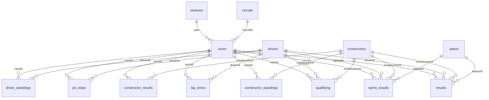

# F1 Dataset — Structure & Guide

Source: Kaggle *Formula 1 World Championship (1950–2024)* (Ergast API export), stored in `dataset/archive/`.
It is a **relational** dataset: 14 CSV tables linked by ID columns, like a small SQL database. No single file
answers the project question, so you always join several tables.

**Project framing (from `Description.pdf`)**
- **Unit of analysis / grain:** one driver in one race → `(raceId, driverId)`.
- **Target:** `podium = results.positionOrder <= 3`.
- **Prediction cutoff:** after qualifying, before lights out. Anything produced *by the race itself* is leakage.

---

## 1. The big picture: how the tables connect

`races` is the centre of the dataset. Almost every other table is either a **lookup** (who/where/what) or a
**record of something that happened at a race** (keyed by `raceId`, plus `driverId` and/or `constructorId`).

Notes:
- A driver's team is **not** stored in `drivers`. It lives in each race row (`results.constructorId`,
  `qualifying.constructorId`), because drivers change teams.
- All foreign keys reconcile: every ID in a child table exists in its parent table (0 orphans, verified).

---

## 2. The tables, grouped by role

### A. Reference / lookup tables: "who, where, what" (static, no leakage)

| Table | Rows | Primary key | Grain | Main columns |
|---|---:|---|---|---|
| `seasons` | 75 | `year` | one championship year (1950–2024) | `url` |
| `circuits` | 77 | `circuitId` | one track | `circuitRef`, `name`, `location`, `country`, `lat`, `lng`, `alt` |
| `drivers` | 861 | `driverId` | one driver (ever) | `driverRef`, `number`, `code`, `forename`, `surname`, `dob`, `nationality` |
| `constructors` | 212 | `constructorId` | one team **name** | `constructorRef`, `name`, `nationality` |
| `status` | 139 | `statusId` | one finishing-status label | `status` (e.g. `Finished`, `+1 Lap`, `Engine`, `Collision`, `Did not qualify`) |

Things to watch:
- `circuits.country` uses both `USA` and `United States` for the same country.
- `drivers.nationality` has `Argentinian ` (with a trailing space) next to `Argentine`.
- `drivers.number` (93 % `\N`) and `drivers.code` (88 % `\N`): permanent numbers and codes only exist in the modern era.
- `constructors` holds one row per **name**, so rebrands become separate IDs (Toro Rosso → AlphaTauri → RB,
  Force India → Racing Point → Aston Martin, Sauber → Alfa Romeo → Sauber). The dataset doesn't link them.
- `status` mixes four kinds of label: classified finishes (`Finished`, `+N Laps`), mechanical failures
  (`Engine`, `Gearbox`, …), incidents (`Accident`, `Collision`, `Spun off`, …) and administrative ones
  (`Disqualified`, `Excluded`, `Withdrew`, `Did not qualify`, `107% Rule`, …).

### B. The calendar / event table: the hub

| Table | Rows | Primary key | Grain | Main columns |
|---|---:|---|---|---|
| `races` | 1,125 | `raceId` (also unique: `year`+`round`) | one Grand Prix | `year`, `round`, `circuitId`, `name`, `date`, `time`, `fp1–3_date/time`, `quali_date/time`, `sprint_date/time` |

- `round` is the race's position in its season. Rounds have no gaps (1…n every year), so "the previous race of
  the season" is simply `round − 1`.
- The `fp*`, `quali_*` and `sprint_*` columns are only filled from **2021**, and `time` from **2005**. Earlier
  rows hold `\N`.
- 1950–1960 include the **Indianapolis 500**, which counted for the championship but was raced almost entirely
  by American specialists who entered no other rounds.

### C. Per-race, per-driver event tables: the "facts"

| Table | Rows | Key | Grain | Years | Timing vs. cutoff |
|---|---:|---|---|---|---|
| `qualifying` | 10,494 | `qualifyId` (natural: `raceId`+`driverId`, unique) | driver × race qualifying session | 1994–2024 | ✅ **Before** the race |
| `results` | 26,759 | `resultId` (natural `raceId`+`driverId` has **85 duplicate pairs**) | driver × car × race | 1950–2024 | Mixed, see below |
| `sprint_results` | 360 | `resultId` (natural: `raceId`+`driverId`) | driver × sprint race | 2021–2024 (18 events) | ✅ Before the Sunday race |
| `lap_times` | 589,081 | `raceId`+`driverId`+`lap` | one lap of one driver | 1996–2024 | ❌ During the race |
| `pit_stops` | 11,371 | `raceId`+`driverId`+`stop` | one pit stop | 2011–2024 | ❌ During the race |

#### `results`: the central fact table. Read it carefully.

| Column | Meaning | Allowed as a feature? |
|---|---|---|
| `raceId`, `driverId`, `constructorId` | who drove for which team in which race | ✅ (identifiers) |
| `number` | car number | ✅ (not useful) |
| `grid` | **final** starting slot, after penalties. `0` = pit-lane start, or not recorded in old seasons | ✅ |
| `position` | classified finishing position; `\N` if not classified | ❌ |
| `positionText` | `position` as text, or a code: `R` retired, `D` disqualified, `E` excluded, `W` withdrew, `F` failed to qualify, `N` not classified | ❌ |
| `positionOrder` | **always filled** finishing order (used for ranking everyone) → **the target** | ❌ (target) |
| `points`, `laps`, `time`, `milliseconds` | race outcome | ❌ |
| `fastestLap`, `rank`, `fastestLapTime`, `fastestLapSpeed` | fastest-lap info (≈ 2004+) | ❌ |
| `statusId` → `status` | how the race ended | ❌ |

Why `results` has duplicate `(raceId, driverId)` rows: in early F1 (mostly 1950–1964, plus one 1978 DNQ/DNPQ
pair) a driver could **share a drive**, i.e. take over a team-mate's car mid-race. Each car the driver drove
gets its own row. 79 pairs appear twice and 6 appear three times. Because of this, `positionOrder` is not unique
inside some old races, and a few races have 4–5 drivers with `positionOrder ≤ 3`.

`results` also holds **entries that never started** (`Did not qualify`, `Did not prequalify`, `107% Rule`,
and most `Withdrew` rows with `laps = 0`). They are not real race starts.

#### `qualifying`
- `position` = qualifying classification. It can differ from `results.grid` because of grid penalties: in
  2014+ the two differ for about 32 % of drivers.
- `q1`, `q2`, `q3` are lap-time strings like `"1:26.572"`. They are blank (`\N` or the empty string `""`)
  when the driver was eliminated earlier or set no time. Since 2006 there is a knockout format, so a missing
  `q3` means "knocked out", not "unknown".
- **Coverage drift:** no rows before 1994, patchy from 1996 to 2002 (6–59 % of starters), complete from **2003**.
  This is the main reason to model 2003–2024.
- Anomalies: one `q1 = "16:42.640"` (raceId 255, an obvious data error), and very slow times in wet or
  red-flagged sessions.

### D. Cumulative championship tables: standings **after** each race

| Table | Rows | Key | Grain | Years |
|---|---:|---|---|---|
| `driver_standings` | 34,863 | `driverStandingsId` (natural: `raceId`+`driverId`) | driver's championship position **after** race `raceId` | 1950–2024 |
| `constructor_standings` | 13,391 | `constructorStandingsId` (natural: `raceId`+`constructorId`) | team's championship position **after** race `raceId` | 1958–2024 |
| `constructor_results` | 12,625 | `constructorResultsId` | points a team scored in one race | 1958–2024 |

⚠️ **Most important leakage trap:** the standings row for `raceId = R` **already includes the points from race R**.
For example, at round 1 the standings points are exactly the race points. To use standings as a feature you must
join the row of the **previous round** (`year`, `round − 1`). At round 1 there are no prior standings.

Quirks:
- `positionText = 'E'` in `constructor_standings`: McLaren were **excluded** from the 2007 constructors'
  championship, so their `position` reads 11 for the whole season even though their car was one of the two fastest.
- `positionText = 'D'` in `driver_standings`: Schumacher was disqualified from the 1997 championship.
- `constructor_results` is the per-race version of `constructor_standings`. Its `status` column is 99.9 % `\N`
  (`'D'` = disqualified).
- `points` follows each era's scoring system (e.g. 10-6-4, 10-8-6, 25-18-15, and double points at Abu Dhabi
  2014, hence a max of 50). Compare points as a **share of the leader** rather than as raw numbers.

---

## 3. Missing values ("sentinels")

Ergast writes missing values as the literal text **`\N`**. `qualifying.q2` and `q3` also contain a few **empty
strings** (22 and 46). Loading with a plain `pd.read_csv` turns any column containing `\N` into text.

| Column | % `\N` | Why it is missing |
|---|---:|---|
| `results.position` | 41 % | driver not classified (DNF, DSQ, DNQ…) |
| `results.time` / `milliseconds` | 71 % | only finishers on the lead lap have a time |
| `results.fastestLap*`, `rank` | ~69 % | not recorded before ~2004, or no lap set |
| `qualifying.q2` / `q3` | 44 % / 65 % | eliminated in Q1/Q2 (knockout format) |
| `races.fp*/quali_*/sprint_*` | 92–99 % | only recorded from 2021, and sprints only on sprint weekends |
| `drivers.number` / `code` | 93 % / 88 % | permanent numbers and codes are modern |
| `constructor_results.status` | 99.9 % | only set when the team was disqualified |

So missingness is almost always **structural** (it has a reason), not random.

## 4. Data types to fix ("semantic typing")

| Raw text | Should become |
|---|---|
| `races.date`, `drivers.dob`, `races.fp*_date`, `quali_date`, `sprint_date` | dates |
| `qualifying.q1/q2/q3`, `results.fastestLapTime`, `sprint_results.fastestLapTime`, `lap_times.time` (`"m:ss.sss"`) | seconds (float) |
| `pit_stops.duration` (`"ss.sss"`, can be `"m:ss.sss"` for red-flag stops) | seconds (float) |
| `results.time` | mixed: absolute time for the winner, `"+gap"` for the others → use `milliseconds` instead |
| `pit_stops.time`, `races.time` | time of day (not a duration) |
| ID and number columns containing `\N` | numeric |

## 5. Column timing classification (leakage cheat-sheet)

| ✅ Known before the race starts | ❌ Only known after / during the race |
|---|---|
| `grid`; `qualifying.position`, `q1–q3` | `results.positionOrder/position/positionText/points/laps/time/milliseconds/status*` |
| driver `dob`, `nationality`; circuit `country`; team | `results.fastestLap*`, `rank` |
| results, standings and pit stops of **previous** races | `lap_times`, `pit_stops` of the **same** race |
| `driver_standings` / `constructor_standings` of **round − 1** | `driver_standings` / `constructor_standings` / `constructor_results` of the **same** `raceId` |
| sprint results of the same weekend (the sprint runs before the Grand Prix) | |

## 6. Key numbers

- 1,125 races over 75 seasons, with 7 to 24 races per season and a 2024 calendar of 24 races (last one 2024-12-08).
- 26,759 result rows. After removing shared-drive duplicates and non-qualifiers, about 25.3 k race starts.
- Podium base rate is about 13–14 % → an **imbalanced** binary target (PR-AUC is the informative metric).
- Modeling window 2003–2024 gives about 9 k driver-race rows.
